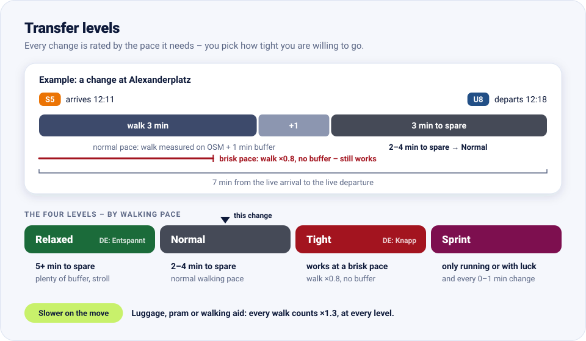
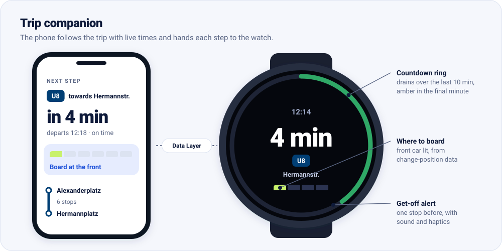
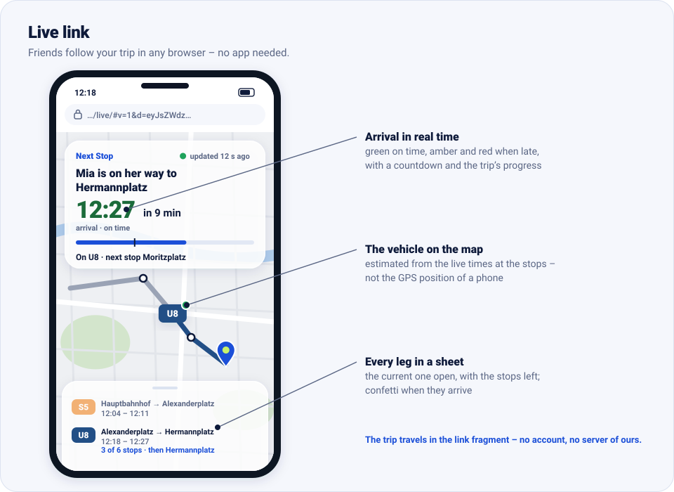
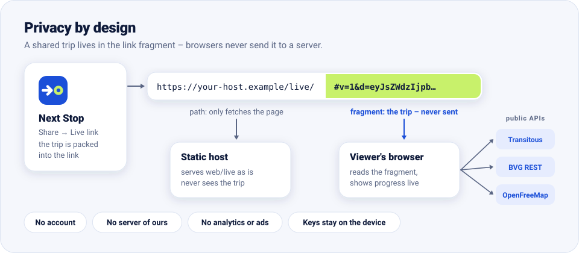

<div align="center">

<picture>
  <source media="(prefers-color-scheme: dark)" srcset="docs/images/hero-dark.svg">
  
</picture>

<br>

[](#getting-started)
[](#live-trip)
[](https://kotlinlang.org)
[](https://developer.android.com/compose)
[](LICENSE)
[](#privacy)

**Berlin first, all of Germany on board.**<br>
Knows how long a change really takes, where to board, when a faster way turns up and when to get off –<br>
on the phone, on the watch and on a page your friends can follow.

[Highlights](#highlights) · [How it works](#how-it-works) · [Getting started](#getting-started) · [Data & attribution](#data-sources-and-attribution) · [Privacy](#privacy) · [Roadmap](#roadmap)

</div>

> [!NOTE]
> **In active development.** The phone app, the Wear OS app, the live page and the route page work; there is no release yet.

<details>
<summary><b>Contents</b></summary>

- [Highlights](#highlights) · [All features](#all-features)
- [How it works](#how-it-works)
  - [Transfer levels](#transfer-levels) · [Chart view](#chart-view) · [Setup and settings](#setup-and-settings) · [Live trip](#live-trip)
  - [Live link and route link](#live-link-and-route-link) · [Little motions](#little-motions) · [Timetable sources](#timetable-sources) · [From OpenStreetMap to the app](#from-openstreetmap-to-the-app)
- [Screenshots](#screenshots)
- [Architecture](#architecture)
- [Getting started](#getting-started) – build, keys, tests, station data, web pages
- [Data sources and attribution](#data-sources-and-attribution)
- [Privacy](#privacy) · [Roadmap](#roadmap) · [Contributing](#contributing) · [For developers](#for-developers) · [License](#license)

</details>

## Highlights

Most journey planners stop caring the moment you pick a connection. Next Stop keeps going – built
on open data and community services, with no account and no server of its own.

<table>
<tr>
<td width="33%" valign="top">
<br>
<b>Transfer levels</b><br>
Every change rated <i>relaxed</i>, <i>normal</i>, <i>tight</i> or <i>sprint</i> by the walking pace it needs – from live times and the real walk. You set how tight you go.
</td>
<td width="33%" valign="top">
<br>
<b>Exact transfer walks</b><br>
Measured on the station's OpenStreetMap footways – stairs, lifts and platforms, not straight lines.
</td>
<td width="33%" valign="top">
<br>
<b>Live trip</b><br>
Next step, countdown and stops left with live times – in the app and as a live notification.
</td>
</tr>
<tr>
<td valign="top">
<br>
<b>Boarding hints</b><br>
<i>Board at the front, middle or rear</i> – and be first at the stairs for your connection.
</td>
<td valign="top">
<br>
<b>Shortcut alert</b><br>
Keeps searching while you ride and speaks up when a faster way turns up.
</td>
<td valign="top">
<br>
<b>Get-off reminders</b><br>
Sound and vibration one stop before you get off, at every change – on the watch too.
</td>
</tr>
<tr>
<td valign="top">
<br>
<b>Live vehicles</b><br>
Buses and trains around you on the map, placed from real-time data, with their direction.
</td>
<td valign="top">
<br>
<b>Stations up close</b><br>
Entrances, accesses through buildings, lifts and the stop positions of bus and tram stops.
</td>
<td valign="top">
<br>
<b>Made for Wear OS</b><br>
Tiles, a complication, live trip pages, a map and standalone search on the wrist.
</td>
</tr>
<tr>
<td valign="top">
<br>
<b>Live link</b><br>
Friends follow your trip in any browser – or get a connection as a step-by-step page to travel themselves.
</td>
<td valign="top">
<br>
<b>All of Germany</b><br>
Station data for all 16 states from OpenStreetMap; timetables nationwide through Transitous.
</td>
<td valign="top">
<br>
<b>Private by design</b><br>
No account, no ads, no tracking – and no server of ours in between.
</td>
</tr>
</table>

### All features

<details>
<summary><b>Plan</b> – transfer levels, through-runs, means of transport, bike combo, chart view</summary>

| | |
|---|---|
| **Transfer levels** | Every change is rated by the live times and the walking pace it needs: *relaxed* (plenty of buffer, stroll), *normal* (normal walking pace), *tight* (works at a brisk pace) and *sprint* (only running or with luck, and every 0–1 min change). German UI: Entspannt, Normal, Knapp, Sprint. |
| **Slower on the move** | With luggage, a pram or a walking aid every walk counts 1.3 times as long, at every level. |
| **Exact transfer walks** | Change walks are measured on the OpenStreetMap footway network of the station. |
| **Through-runs** | When your train continues as another line, the app tells you to *stay seated* and which line it continues as. |
| **Means of transport** | S-Bahn, U-Bahn, tram, bus, ferry, regional – plus *Long-distance* (ICE, IC, EC, RJ …) and *Coach* (FlixBus …) as categories of their own, globally or per search. |
| **Deutschlandticket** | One switch turns long-distance and coach off together (the ticket covers neither); off again turns them back on. |
| **With bicycle** | Only show rides that take a bicycle along. |
| **Bike combo** | Cycle the first and last mile, take the bike on S-Bahn, U-Bahn, tram and regional trains; buses and coaches only where they carry bikes, otherwise that stretch is cycled. |
| **Chart or list** | Connections as columns on a shared time axis, one block per leg, the change minutes in the colour of their wait – or as a classic list. Via stops with an optional stay. |
| **Delays** | Three ways to show a late departure: new time + delay (default, `12:09 +2`), planned time + delay (`12:07 +2`), or the coloured new time alone. |

</details>

<details>
<summary><b>Ride</b> – live trip, boarding hints, shortcut alert, reminders</summary>

| | |
|---|---|
| **Live trip** | Follows your trip with live times: the next step, the countdown to the departure, the stops left – in the app and as a live notification. |
| **Boarding hints** | *Board at the front / middle / rear* from change-position data; estimated for changes to buses and trams. |
| **Shortcut alert** | Searches in the background while you ride and alerts you when a faster way turns up – optionally only equally comfortable ones. |
| **Every minute counts** | A per-trip mode: sprint changes allowed, shortcut alert on, searching again from the next stop you can reach. |
| **Get-off reminders** | Sound and vibration one stop before you get off and shortly before arrival, at every change. |
| **Walk rerouting** | If you leave the planned walk, the way is recomputed and tells you what it costs. |

</details>

<details>
<summary><b>Map</b> – live vehicles, stations, stop positions, search</summary>

| | |
|---|---|
| **Live vehicles** | Buses and trains around you, placed from real-time data, with a live dot and their direction; without a dot they run by the timetable. |
| **One card at a time** | Tap a stop, a vehicle or a place and one card shows it – with distances, and a map style of your choice (light, colourful, dark or automatic). |
| **Stations up close** | Entrances and exits of U- and S-Bahn stations, accesses through buildings and lifts – shown automatically by zoom, always, or only at the station you picked. |
| **Stop positions** | The individual stop positions (*Pos.*) of bus and tram stops, with the lines that stop at each. |
| **Search** | Place search over OpenStreetMap data, plus saved places, recent trips and contacts. |

</details>

<details>
<summary><b>Watch</b> – tiles, complication, live trip pages, map, search</summary>

| | |
|---|---|
| **Tiles & complication** | *Next departure* and *Favourite* tiles and a complication on the watch face. |
| **Live trip pages** | Swipe through depart, ride, change and overview pages during a trip; get-off alerts with haptics. |
| **Map** | A map of the stops and departures nearby. |
| **Standalone search** | Type or speak a destination on the watch; it uses the phone's position or its own. |

</details>

<details>
<summary><b>Share, data and more</b> – live link, route link, state packs, widgets, settings</summary>

| | |
|---|---|
| **As text** | A clean text summary of the connection for any messenger. |
| **Live link** | A static web page (`web/live`) where others watch your trip live in the browser. |
| **Route link** | A static web page (`web/route`, "So kommst du hin") that turns a shared connection into steps to travel yourself, with live times. |
| **State packs** | Station, entrance, change-position and transfer-walk data for all 16 German states, built from OpenStreetMap. |
| **Line colours** | From the providers' feeds and OpenStreetMap route relations, picked by place – tram 1 in Mannheim is not tram 1 in Karlsruhe. |
| **Many sources** | Berlin/Brandenburg through VBB and BVG, the rest of Germany (long-distance trains included) through Transitous. |
| **Widgets** | Departures, favourite, current trip, mini, next appointment and an automatic one that shows what matters now. |
| **Disruptions** | Notices for your saved routes, with an optional morning check. |
| **Lift status** | accessibility.cloud and DB FaSta, with warnings for lifts out of order on a journey. |
| **Fare zone hint** | A tag when a journey reaches VBB zone C. |
| **Next appointment** | From your calendar, with when to leave for it. |
| **Settings** | Everyday choices up front; data sources, API keys, an own server, the live page address and developer options under *Advanced*. |

</details>

## How it works

### Transfer levels

<picture>
  <source media="(prefers-color-scheme: dark)" srcset="docs/images/diagram-transfer-levels-dark.svg">
  
</picture>

A change needs 1 min on the same platform, 3 to another, 5 at large rail stations, or its walk
plus 1 min. Beyond that, 5 spare minutes are *relaxed* and 2 *normal*. If it still works at a brisk
pace – the walk ×0.8 and no buffer, at least 2 min – it is *tight*; otherwise it is a *sprint*. A
journey found only by a search without any minimum change time counts as tight at least. The
rules live in `Models.kt` (`changeNeed`, `paceTightness`, `journeyChangeRatings`) and
`WalkPace.kt` (brisk and slower walking).

### Chart view

<picture>
  <source media="(prefers-color-scheme: dark)" srcset="docs/images/diagram-chart-dark.svg">
  
</picture>

### Setup and settings

<picture>
  <source media="(prefers-color-scheme: dark)" srcset="docs/images/diagram-setup-dark.svg">
  
</picture>

The same sketches move when you pick an option, and stand still when the system has animations
turned off.

### Live trip

<picture>
  <source media="(prefers-color-scheme: dark)" srcset="docs/images/diagram-companion-dark.svg">
  
</picture>

### Live link and route link

<table>
<tr>
<td width="50%" valign="top">

<picture>
  <source media="(prefers-color-scheme: dark)" srcset="docs/images/preview-live-page-dark.svg">
  
</picture>

</td>
<td width="50%" valign="top">

<picture>
  <source media="(prefers-color-scheme: dark)" srcset="docs/images/preview-route-page-dark.svg">
  
</picture>

</td>
</tr>
</table>

Both are static pages in `web/`; the trip or connection travels in the link fragment, and the
viewer's browser asks the public timetable APIs itself.

### Little motions

<table>
<tr>
<td width="33%" align="center"><picture>
  <source media="(prefers-color-scheme: dark)" srcset="docs/images/anim-train-loader-dark.svg">
  
</picture><br><sub>Loading</sub></td>
<td width="33%" align="center"><picture>
  <source media="(prefers-color-scheme: dark)" srcset="docs/images/anim-stop-hop-dark.svg">
  
</picture><br><sub>Picking a stop</sub></td>
<td width="33%" align="center"><picture>
  <source media="(prefers-color-scheme: dark)" srcset="docs/images/anim-arrival-dark.svg">
  
</picture><br><sub>Arrival</sub></td>
</tr>
</table>

Short, soft and never in the way – and off when the system asks for reduced motion.

### Timetable sources

<picture>
  <source media="(prefers-color-scheme: dark)" srcset="docs/images/diagram-data-sources-dark.svg">
  
</picture>

The first three share VBB stop ids, so a stop found by one can be asked about at another.
Details: `SourceChain.kt` and `FamilySource.kt`.

### From OpenStreetMap to the app

<picture>
  <source media="(prefers-color-scheme: dark)" srcset="docs/images/diagram-osm-pipeline-dark.svg">
  
</picture>

The pipeline needs no public server: it reads local Geofabrik `.osm.pbf` files. See
[tools/README.md](tools/README.md).

## Screenshots

*Screenshots are coming soon.* How to take them: [docs/screenshots/README.md](docs/screenshots/README.md).

<details>
<summary>Planned layout</summary>

<!--
| Start | Connections | Live trip | Map | Watch |
|:---:|:---:|:---:|:---:|:---:|
|  |  |  |  |  |
-->

| Start | Connections | Live trip | Map | Watch |
|:---:|:---:|:---:|:---:|:---:|
| `start.png` | `connections.png` | `companion.png` | `map.png` | `watch.png` |

</details>

## Architecture

```
app/     Android phone app – Kotlin, Jetpack Compose, MapLibre, Glance widgets
wear/    Wear OS app – Compose for Wear OS, tiles, complication, Data Layer link to the phone
web/     Static pages: live tracking, route links and the info site – plain JS, no build step, offline tests
tools/   Python pipeline that turns OpenStreetMap data into the app's station assets
docs/    Design spec, key handling, licences, README images
```

<details>
<summary><b>Tech stack</b></summary>

| | Version |
|---|---|
| Kotlin | 2.2.10 |
| Android Gradle Plugin / Gradle | 9.5.1 / 9.6.0 |
| Jetpack Compose BOM (Material 3) | 2026.02.01 |
| Activity Compose | 1.13.0 |
| Kotlin Coroutines | 1.10.2 |
| MapLibre Android | 11.8.0 |
| Glance (widgets) | 1.2.0 |
| WorkManager | 2.12.0 |
| OkHttp | 5.4.0 |
| Compose for Wear OS | 1.7.1 |
| Wear Tiles / ProtoLayout | 1.6.2 / 1.4.2 |
| Play Services Wearable | 20.0.1 |
| public-transport-enabler | pinned commit via JitPack |

Phone: min SDK 31 (Android 12), target SDK 37. Watch: min SDK 30 (Wear OS 3), target SDK 36.

</details>

## Getting started

**You need** a recent Android Studio, JDK 17 or newer (the bundled JetBrains Runtime works),
Node.js for the web tests and Python 3 for the data tools.

```bash
git clone <this repository>
cd next-stop
./gradlew assembleDebug          # phone and watch debug APKs
./gradlew :app:installDebug      # install the phone app on a connected device
```

### Keys (optional)

Some sources need an access key. Copy `secrets.properties.example` to `secrets.properties`
(gitignored) and fill in what you have; the build turns the values into built-in keys. Without
it, keyed sources stay off until a key is entered in the settings – and a key entered there
always wins. Never commit keys and do not publish builds with keys built in.
More: [docs/keys.md](docs/keys.md).

<details>
<summary><b>Building without public-transport-enabler</b></summary>

The library comes from JitPack, pinned to a commit. If JitPack fails to build it, set

```properties
# gradle.properties
nextstop.pte=false
```

The app then compiles `app/src/nopte/` instead of `app/src/pte/` and shows that source as
"not included in this build".

</details>

### Tests

```bash
./gradlew test                              # unit tests (phone and watch)
node web/test/live.test.js                  # live page, offline
node web/test/route.test.js                 # route page, offline
python3 tools/test_build_station_asset.py   # data pipeline self-tests
python3 tools/test_build_transfer_walks.py
python3 tools/test_extract_osm_pbf.py
```

### Station data and web pages

- **Station data** – the OpenStreetMap assets are committed. To rebuild them from a Geofabrik
  extract (state by state or all of Germany), follow [tools/README.md](tools/README.md).
- **Live and route pages** – `web/` is static and served at `https://nextstop.bapo.me`, where the
  app's links lead by default. To use your own copy, upload it to any static host (Cloudflare
  Pages, GitHub Pages, …) and enter its address in the app's settings (*Advanced*). Open `…/live/#demo`
  or `…/route/#demo` for made-up examples. See [web/README.md](web/README.md).
- **Info site** – `web/index.html` (German) and `web/en/` (English) are the project's website,
  with its assets in `web/site/`. They sit beside the pages above and need nothing else.

## Data sources and attribution

| Data | Source | License |
|---|---|---|
| Map and station data | © [OpenStreetMap contributors](https://www.openstreetmap.org/copyright) | ODbL 1.0 |
| Map tiles | [OpenFreeMap](https://openfreemap.org) | OpenStreetMap data, ODbL |
| Place search | [Photon](https://photon.komoot.io) (komoot) | OpenStreetMap data, ODbL |
| Walking and cycling paths | [OSRM](https://routing.openstreetmap.de) (FOSSGIS e.V.) | OpenStreetMap data, ODbL |
| Timetables, Germany | [Transitous](https://transitous.org) – sources at [transitous.org/sources](https://transitous.org/sources/) | per feed |
| Timetables, Berlin/Brandenburg | VBB HAFAS ReST API, BVG REST ([v6.bvg.transport.rest](https://v6.bvg.transport.rest)) | per provider terms |
| Change positions | [vbb-change-positions](https://github.com/derhuerst/vbb-change-positions) | ODbL |
| Lift status | [accessibility.cloud](https://accessibility.cloud) (brokenlifts.org), DB FaSta | provider terms |
| Cloud cover (sunny side hint) | [Open-Meteo](https://open-meteo.com) | CC BY 4.0 |
| Library | [public-transport-enabler](https://github.com/schildbach/public-transport-enabler) | GPL-3.0 |
| Font | Google Sans Flex | SIL OFL 1.1 ([text](docs/licenses/GoogleSansFlex-OFL.txt)) |

The app lists every source with its attribution under *Settings › About Next Stop › Data sources
& attribution*, which the small "i" under the location button of the map opens too; "Map data
© OpenStreetMap contributors" also stays at the end of the settings, below place search results
and as "© OSM" on the watch maps, and the Transitous sources are linked there and in *Advanced*.
Third-party components are listed in [NOTICE](NOTICE) and in the app (*About Next Stop ›
Open-source licenses*, from `data/ThirdPartyNotices.kt`, which a unit test holds against
`gradle/libs.versions.toml`).

## Privacy

<picture>
  <source media="(prefers-color-scheme: dark)" srcset="docs/images/diagram-privacy-dark.svg">
  
</picture>

- **No account, no ads, no analytics, no crash reporting.** The app contains no tracking SDK.
- **No server of ours.** Requests go straight from your device to the timetable, map and search
  services you enabled; the live page asks the public APIs from the viewer's browser.
- **Your keys stay on your device** and are excluded from backups.
- **Map links you open with Next Stop** ("navigate here" from another app) are read on your
  device. Only a short link of Google Maps (maps.app.goo.gl/…) has to be asked once at its own
  host where it leads; the map page behind it is not loaded.
- **Android's backup** (Google backup and phone-to-phone transfer) takes your settings,
  favourites, saved places, "Meine Wege" and recent destinations, so a new phone starts where the
  old one left off; cloud backup only where Android can encrypt it on the device (a screen lock is
  set). Keys, caches, downloaded OpenStreetMap data and the widgets' state are left out
  (`app/src/main/res/xml/data_extraction_rules.xml`; the watch app likewise keeps its settings and
  leaves out cached departures). Turn it off in the system settings under Google › Backup.
- **Permissions for features only:** location (nearby stops, the live trip), notifications (trip
  and get-off reminders), and – only if you turn them on – contacts and calendar.

## Roadmap

- [x] GPL-3.0 `LICENSE`
- [ ] First release
- [ ] Screenshots and a store listing
- [ ] More networks beyond Berlin/Brandenburg with the same depth (boarding hints, lifts)
- [ ] Keep the OpenStreetMap state packs fresh with a regular rebuild

## Contributing

Bug reports, ideas and pull requests are welcome.

- Everything in the repository is written in English (the app itself has English and German UI).
- No personal data, credentials, or home or work addresses in code, sample data or screenshots;
  use well-known central stations as examples.
- Never commit keys (see [docs/keys.md](docs/keys.md)), and run the tests above before opening a
  pull request.
- Design notes live in [docs/design-spec.md](docs/design-spec.md).
- By opening a pull request you agree that your contribution is licensed under GPLv3 with the
  [app store permission](LICENSE-EXCEPTION.md).

## For developers

- [ARCHITECTURE.md](ARCHITECTURE.md) – modules, package map, data sources and routing, offline OSM data, map rendering, disruptions, walks, startup, the Wear OS app
- [docs/development.md](docs/development.md) – setup, building phone and watch, signing, tests, regenerating the station data, audits, debugging
- [docs/conventions.md](docs/conventions.md) – the engineering rules of the project
- [CONTRIBUTING.md](CONTRIBUTING.md) – how to contribute
- Also: [docs/design-spec.md](docs/design-spec.md), [docs/keys.md](docs/keys.md), [docs/play-release.md](docs/play-release.md), [tools/README.md](tools/README.md), [web/README.md](web/README.md)

## License

Next Stop is licensed under the [GNU General Public License v3.0](LICENSE) – it links
[public-transport-enabler](https://github.com/schildbach/public-transport-enabler), which is
GPL-3.0 as well. Third-party components and their licences are listed in [NOTICE](NOTICE).

**App store permission.** Next Stop's own code comes with an
[additional permission under GPLv3 section 7](LICENSE-EXCEPTION.md): it may also be
distributed through app stores whose terms add restrictions for users (such as Apple's App
Store), as long as the full source stays freely available under GPLv3 and the app says where
to find it. The permission covers only Next Stop's own code – third-party components such as
public-transport-enabler keep their plain licences. Contributions are accepted under GPLv3
with this permission.

Map data © OpenStreetMap contributors, available under the Open Database License.
