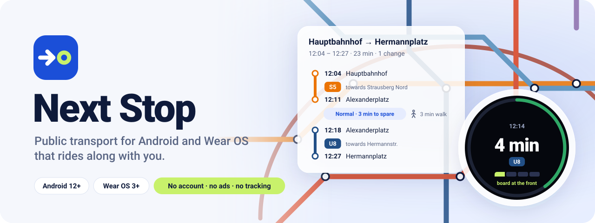
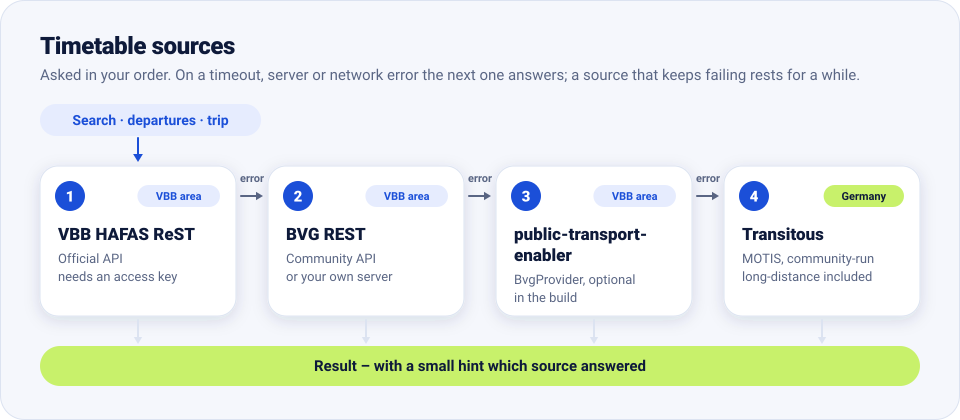
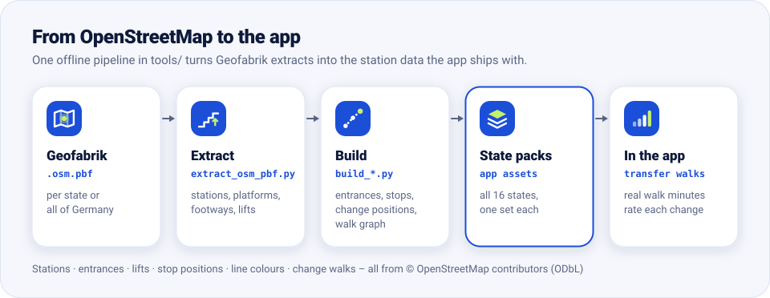
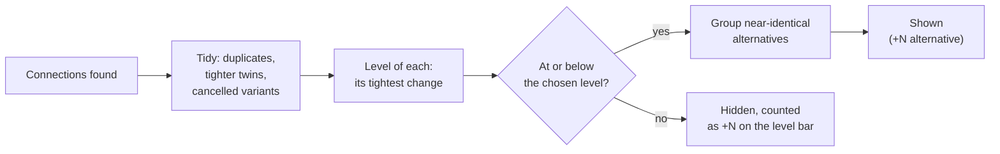
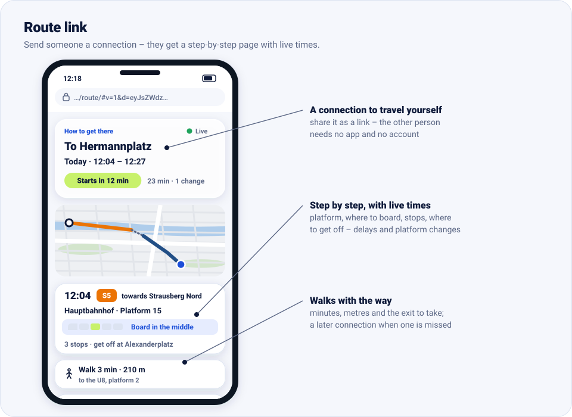
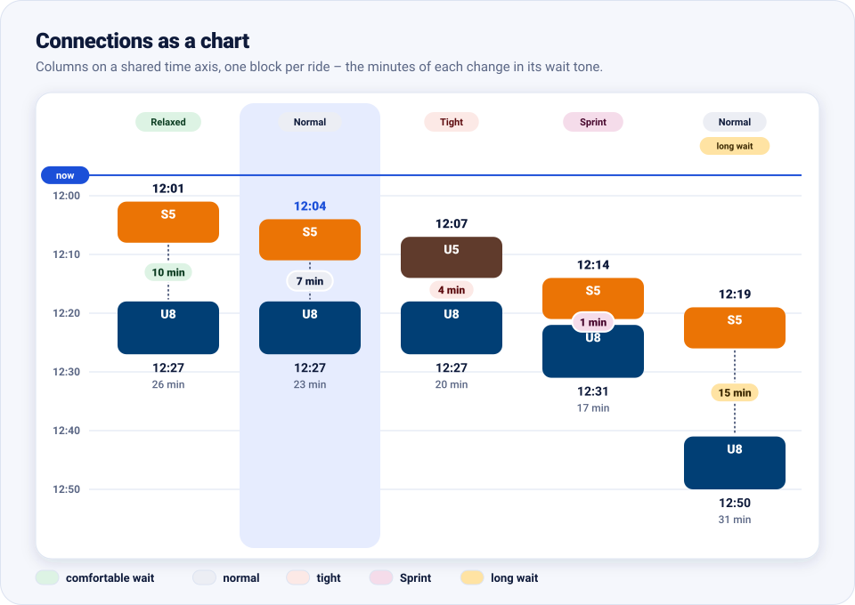
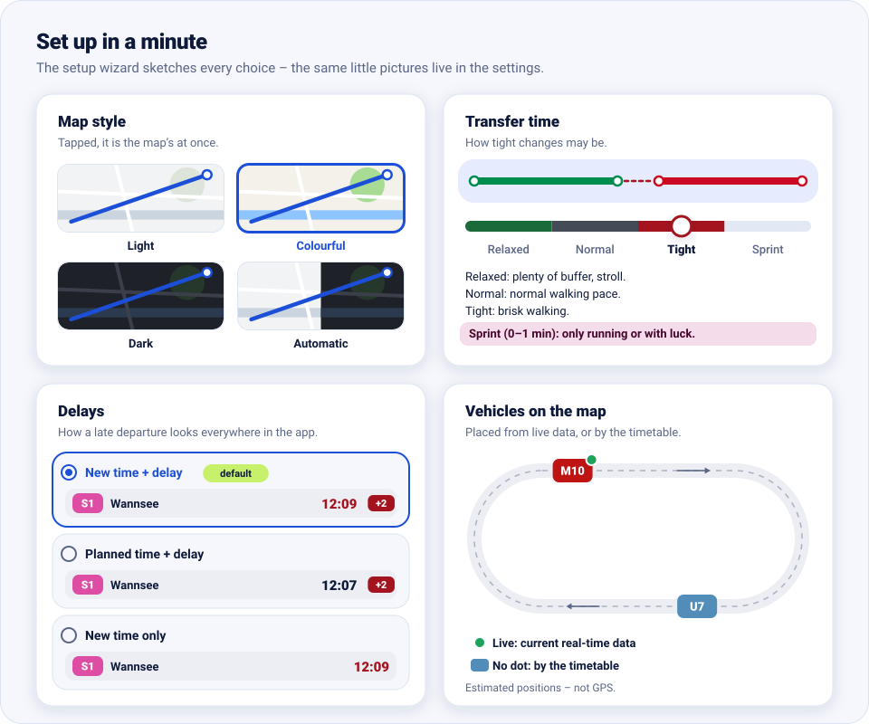
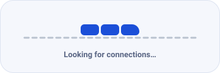

<div align="center">

<picture>
  <source media="(prefers-color-scheme: dark)" srcset="docs/images/hero-dark.svg">
  
</picture>

<br>

[](#getting-started)
[](#live-trip)
[](https://kotlinlang.org)
[](https://developer.android.com/compose)
[](LICENSE)
[](#privacy)

A public transport app for Android and Wear OS that follows your whole trip: transfers rated from live times and real walking distances, boarding hints, a live trip on phone and watch, and links to share it.

[Highlights](#highlights) · [How it works](#how-it-works) · [Getting started](#getting-started) · [Data & attribution](#data-sources-and-attribution) · [Privacy](#privacy) · [Roadmap](#roadmap)

</div>

> [!NOTE]
> **Version 0.2.0** is in internal testing on Google Play; the GitHub release follows. Work on **0.3** is under way
> on the development branch. Parts that exist only there are marked *0.3*.

<details>
<summary><b>Contents</b></summary>

- [Highlights](#highlights) · [All features](#all-features)
- [How it works](#how-it-works)
  - [Where the data comes from](#where-the-data-comes-from) – timetables, realtime, station data, other services
  - [How connections are chosen](#how-connections-are-chosen) – levels, selector, grouping, 0.3 work
  - [Smart hints while planning and riding](#smart-hints-while-planning-and-riding)
  - [Live trip and sharing](#live-trip-and-sharing) – live trip, live and route link, chart view, setup, little motions
- [Screenshots](#screenshots)
- [Architecture](#architecture)
- [Getting started](#getting-started) – build, keys, tests, station data, web pages
- [Data sources and attribution](#data-sources-and-attribution)
- [Privacy](#privacy) · [Roadmap](#roadmap) · [Contributing](#contributing) · [For developers](#for-developers) · [License](#license)

</details>

## Highlights

Most journey planners stop caring the moment you pick a connection. Next Stop keeps going – built
on open data and community services, with no account and no server of its own.

<table>
<tr>
<td width="33%" valign="top">
<br>
<b>Transfer levels</b><br>
Every change rated <i>relaxed</i>, <i>normal</i>, <i>tight</i> or <i>sprint</i> by the walking pace it needs – from live times and the real walk. You set how tight you go.
</td>
<td width="33%" valign="top">
<br>
<b>Exact transfer walks</b><br>
Measured on the station's OpenStreetMap footways – stairs, lifts and platforms, not straight lines.
</td>
<td width="33%" valign="top">
<br>
<b>Live trip</b><br>
Next step, countdown and stops left with live times – in the app and as a live notification.
</td>
</tr>
<tr>
<td valign="top">
<br>
<b>Boarding hints</b><br>
<i>Board at the front, middle or rear</i> – and be first at the stairs for your connection.
</td>
<td valign="top">
<br>
<b>Shortcut alert</b><br>
Keeps searching while you ride and speaks up when a faster way turns up.
</td>
<td valign="top">
<br>
<b>Get-off reminders</b><br>
Sound and vibration one stop before you get off, at every change – on the watch too.
</td>
</tr>
<tr>
<td valign="top">
<br>
<b>Live vehicles</b><br>
Buses and trains around you on the map, placed from real-time data, with their direction.
</td>
<td valign="top">
<br>
<b>Stations up close</b><br>
Entrances, accesses through buildings, lifts and the stop positions of bus and tram stops.
</td>
<td valign="top">
<br>
<b>Made for Wear OS</b><br>
Tiles, a complication, live trip pages, a map and standalone search on the wrist.
</td>
</tr>
<tr>
<td valign="top">
<br>
<b>Live link</b><br>
Friends follow your trip in any browser – or get a connection as a step-by-step page to travel themselves.
</td>
<td valign="top">
<br>
<b>All of Germany</b><br>
Station data for all 16 states from OpenStreetMap; timetables nationwide through Transitous.
</td>
<td valign="top">
<br>
<b>Private by design</b><br>
No account, no ads, no tracking – and no server of ours in between.
</td>
</tr>
</table>

### All features

<details>
<summary><b>Plan</b> – transfer levels, through-runs, means of transport, bike combo, chart view</summary>

| | |
|---|---|
| **Transfer levels** | Every change is rated by the live times and the walking pace it needs: *relaxed* (5 or more spare minutes), *normal* (1 to 4), *tight* (works at a brisk pace) and *sprint* (only running or with luck, and every 0–1 min change). Details: [How connections are chosen](#how-connections-are-chosen). |
| **Slower on the move** | With luggage, a pram or a walking aid every walk counts 1.3 times as long, at every level. |
| **Exact transfer walks** | Change walks are measured on the OpenStreetMap footway network of the station. |
| **Through-runs** | When your train continues as another line, the app tells you to *stay seated* and which line it continues as. |
| **Means of transport** | S-Bahn, U-Bahn, tram, bus, ferry, regional – plus *Long-distance* (ICE, IC, EC, RJ …) and *Coach* (FlixBus …) as categories of their own, globally or per search. |
| **Deutschlandticket** | One switch turns long-distance and coach off together (the ticket covers neither); off again turns them back on. |
| **With bicycle** | Only show rides that take a bicycle along. |
| **Bike combo** | Cycle the first and last mile, take the bike on S-Bahn, U-Bahn, tram and regional trains; buses and coaches only where they carry bikes, otherwise that stretch is cycled. |
| **Chart or list** | Connections as columns on a shared time axis, one block per leg, the change minutes in the colour of their wait – or as a classic list. Via stops with an optional stay. |
| **Delays** | Three ways to show a late departure: new time + delay (default, `12:09 +2`), planned time + delay (`12:07 +2`), or the coloured new time alone. |

</details>

<details>
<summary><b>Ride</b> – live trip, boarding hints, shortcut alert, reminders</summary>

| | |
|---|---|
| **Live trip** | Follows your trip with live times: the next step, the countdown to the departure, the stops left – in the app and as a live notification. |
| **Boarding hints** | *Board at the front / middle / rear* from change-position data; estimated for changes to buses and trams. |
| **Shortcut alert** | Searches in the background while you ride and alerts you when a faster way turns up – optionally only equally comfortable ones. |
| **Every minute counts** | A per-trip mode: sprint changes allowed, shortcut alert on, searching again from the next stop you can reach. |
| **Get-off reminders** | Sound and vibration one stop before you get off and shortly before arrival, at every change. |
| **Walk rerouting** | If you leave the planned walk, the way is recomputed and tells you what it costs. |

</details>

<details>
<summary><b>Map</b> – live vehicles, stations, stop positions, search</summary>

| | |
|---|---|
| **Live vehicles** | Buses and trains around you, placed from real-time data, with a live dot and their direction; without a dot they run by the timetable. |
| **One card at a time** | Tap a stop, a vehicle or a place and one card shows it – with distances, and a map style of your choice (light, colourful, dark or automatic). |
| **Stations up close** | Entrances and exits of U- and S-Bahn stations, accesses through buildings and lifts – shown automatically by zoom, always, or only at the station you picked. |
| **Stop positions** | The individual stop positions (*Pos.*) of bus and tram stops, with the lines that stop at each. |
| **Search** | Place search over OpenStreetMap data, plus saved places, recent trips and contacts. |

</details>

<details>
<summary><b>Watch</b> – tiles, complication, live trip pages, map, search</summary>

| | |
|---|---|
| **Tiles & complication** | *Next departure* and *Favourite* tiles and a complication on the watch face. |
| **Live trip pages** | Swipe through depart, ride, change and overview pages during a trip; get-off alerts with haptics. |
| **Map** | A map of the stops and departures nearby. |
| **Standalone search** | Type or speak a destination on the watch; it uses the phone's position or its own. |

**Watch redesign (*0.3*).** These items are in the code of the 0.3 development branch:

- Start page with a trip card and departures as line-colour capsules; departure board and nearby stops with platform and delay chips, a disruption banner and pull-to-refresh with the crown.
- Route search as *Where to?* with speaking as the main action; results as journey cards with a band of line colours; connection detail and trip overview as one time line.
- Live trip pages redone (depart, ride, change, arrival), and a redesigned wake alarm and watch map.
- Tiles with line-colour capsules, complications with rings in the colour of the line (Wear OS 4 and up), and richer notifications with platform and line badge.
- Settings with real switches and an accent colour page (as on the phone, Next Stop blue, or your own).

</details>

<details>
<summary><b>Share, data and more</b> – live link, route link, state packs, widgets, settings</summary>

| | |
|---|---|
| **As text** | A clean text summary of the connection for any messenger. |
| **Live link** | A static web page (`web/live`) where others watch your trip live in the browser. |
| **Route link** | A static web page (`web/route`) that turns a shared connection into steps to travel yourself, with live times. |
| **State packs** | Station, entrance, change-position and transfer-walk data for all 16 German states, built from OpenStreetMap. |
| **Line colours** | From the providers' feeds and OpenStreetMap route relations, picked by place – tram 1 in Mannheim is not tram 1 in Karlsruhe. |
| **Many sources** | Transitous for all of Germany (long-distance trains included), VBB and BVG for Berlin/Brandenburg, and regional realtime sources on top (*0.3*, see [Where the data comes from](#where-the-data-comes-from)). |
| **Widgets** | Departures, favourite, current trip, mini, next appointment and an automatic one that shows what matters now. |
| **Disruptions** | Notices for your saved routes, with an optional morning check. |
| **Lift status** | accessibility.cloud and DB FaSta, with warnings for lifts out of order on a journey. |
| **Fare zone hint** | A tag when a journey leaves VBB zones A and B. |
| **Next appointment** | From your calendar, with when to leave for it. |
| **Settings** | Everyday choices up front; data sources, API keys, an own server, the live page address and developer options under *Advanced*. |

</details>

## How it works

Next Stop has no server of its own. The app asks public services directly and keeps what it can on the device. This
section follows the path from data to what you see: [where the data comes from](#where-the-data-comes-from),
[how connections are chosen](#how-connections-are-chosen), [the hints](#smart-hints-while-planning-and-riding)
and [the live trip with its links](#live-trip-and-sharing).

### Where the data comes from

| Kind | From | Used for |
|---|---|---|
| Timetables | Transitous, VBB and BVG, public-transport-enabler | Connections, departures, trips |
| Realtime (*0.3*) | Regional overlays on top of Transitous | The freshest live time of each ride |
| Station data | OpenStreetMap, built into state packs | Walks, entrances, platforms, lifts, stop positions |
| Other services | Lift status, place search, map tiles, walking paths, weather | Warnings, search, map, walks, sunny side |

#### Timetables

Transitous (open data, all of Germany, long-distance trains included) is the backbone. For Berlin and Brandenburg the
VBB and BVG servers are asked as well. You order the sources in the settings; the app asks them in that order and falls
back to the next one when one fails.

<picture>
  <source media="(prefers-color-scheme: dark)" srcset="docs/images/diagram-data-sources-dark.svg">
  
</picture>

The first three share VBB stop ids, so a stop found by one can be asked about at another.
Details: `SourceChain.kt` and `FamilySource.kt`.

#### Realtime (*0.3*)

Transitous keeps routing, trips and shapes. On top of it, regional realtime sources are asked for the rides you look at,
and **the freshest plausible live time wins**. Sources are only asked while the app is in front or a live trip runs,
never on a timer of their own, and each feed is downloaded at most once per interval for the whole app. Open feeds that
share trip ids with Transitous are matched by trip id and are authoritative for cancellations of their own trips. The
others are matched by line, stop and planned time. The settings list every source with its holder and licence and let you
switch each one off.

| Source | Kind | Default |
|---|---|---|
| VBB GTFS-RT | open feed, Berlin/Brandenburg | on |
| VBN GTFS-RT | open feed, Bremen/Lower Saxony | on |
| KVV SIRI-ET | open feed, Karlsruhe | on |
| EFA servers of 14 regional associations, through public-transport-enabler, no credentials | public timetable servers, unofficial, never authoritative for cancellations | on |
| gtfs.de service alerts | disruption texts for all of Germany, a large download | off; when switched on, only on Wi-Fi |
| RMV HAPI | official API, needs your own key entered in the settings | off until a key is entered |

Deutsche Bahn's APIs are not used, nor any source that needs a key taken out of another app. Code: `RealtimeOverlays.kt`,
`OverlayChoice.kt`, `SourceChain.kt`.

#### Station data from OpenStreetMap

State packs for all 16 German states are built from OpenStreetMap and shipped as assets, so stations work offline.

| In the packs | Used for |
|---|---|
| Entrances, accesses through buildings, lifts | Station map, step-free walks |
| Platforms and the footways between them | Transfer walks measured on the real network, not as straight lines |
| Stop positions of bus and tram stops | Where to board, with the lines that stop at each |
| Change positions | Where to stand in the train: the open dataset vbb-change-positions for Berlin/Brandenburg, positions worked out from OpenStreetMap elsewhere |

<picture>
  <source media="(prefers-color-scheme: dark)" srcset="docs/images/diagram-osm-pipeline-dark.svg">
  
</picture>

The pipeline needs no public server: it reads local Geofabrik `.osm.pbf` files. See
[tools/README.md](tools/README.md).

#### Other services

| Service | Used for |
|---|---|
| accessibility.cloud and DB FaSta | Lifts out of order (each needs an access key) |
| Photon (komoot) | Place search |
| OpenFreeMap | Map tiles |
| OSRM (FOSSGIS) | Walking and cycling paths |
| Open-Meteo | Cloud cover for the sunny side hint |

The full list with licences is in [Data sources and attribution](#data-sources-and-attribution).

### How connections are chosen

Every change between two rides gets a **level**. A connection has the level of its **tightest change**, and you choose
how tight you are willing to go. Code: `Models.kt`, `WalkPace.kt`, `TransferTuning.kt`, `JourneySelection.kt`,
`JourneyGroups.kt`.

<picture>
  <source media="(prefers-color-scheme: dark)" srcset="docs/images/diagram-transfer-levels-dark.svg">
  
</picture>

#### What a change needs

The **gap** is the time from the live arrival to the live departure. The **need** is what the change takes at your walking
pace. The **spare** minutes are the gap minus the need. A late ride is rated with its live time, not its timetable time.

| Situation | Need |
|---|---|
| Walk known from the OpenStreetMap footways of the station | the walk at your pace plus a change buffer (30 s by default), rounded up to whole minutes, at least 2 min; 1 min on the same platform |
| Same platform, no walk known | 1 min |
| Another platform of the same station | 3 min (5 min at a large rail station with regional or long-distance trains) |
| A walk given by the provider | the walk plus 1 min |

#### The four levels

| Level | Meaning | Default rule |
|---|---|---|
| **Relaxed** | Plenty of buffer | 5 or more spare minutes |
| **Normal** | Normal walking pace is enough | 1 to 4 spare minutes |
| **Tight** | Works only at a brisk pace | Fewer spare minutes, but the gap still covers the walk at 0.8 times its time with no buffer, and is at least 2 min |
| **Sprint** | Only by running or with luck | Everything else, including every change of 0 or 1 min |

Worked example: a measured walk of 3 min gives a need of 4 min (3 min plus 30 s, rounded up).

| Gap | Spare | Level | Why |
|---|---|---|---|
| 9 min | 5 | Relaxed | 5 or more spare |
| 7 min | 3 | Normal | 1 to 4 spare |
| 4 min | 0 | Tight | the brisk walk is 2.4 min, rounded up to 3 min, and fits in 4 |
| 2 min | -2 | Sprint | shorter than the brisk walk |

An arrival that is only estimated (no live data) is rated normal at best.

<details>
<summary><b>Walking pace and tuning</b></summary>

- **Slower on the move** (luggage, a pram, a walking aid) makes every measured walk 1.3 times as long, at every level, and
  asks the providers for slow walking. The same 3 min walk then needs 5 min: the 7 min gap above is Normal with 2 spare
  minutes, and the 9 min gap is Normal instead of Relaxed. You can also set your own factor (0.8 to 2.0).
- The brisk pace of *Tight* is always 0.8 times the walk at the pace you set.
- In the settings you can move the thresholds: Normal from 0 to 3 spare minutes (default 1), Relaxed from 3 to 10 (default
  5), and the change buffer from 0 to 2 min in 30 s steps (default 30 s). The explanation *How transfers are rated* in the
  app is generated from the values in use.

</details>

#### Choosing a level

The level bar has four segments. Picking a level shows **every connection up to that level**.

| You pick | You see |
|---|---|
| Relaxed | relaxed connections |
| Normal | relaxed and normal |
| Tight | relaxed, normal and tight |
| Sprint | all of them |

The bar fills from the left up to your choice. A small figure at the end of the fill walks at Relaxed and Normal and runs
at Tight and Sprint. Tap a segment or drag across the bar to pick.

Next to the next tighter level that still holds hidden connections, a blue **+N** says how many connections that level
would add; tap it to pick that level. It counts only connections that are really new: not the same rides again and not a
variant already shown. A connection without a change (also two rides of one trip, staying on board) cannot be missed and is
always shown. At Sprint at most 6 extra connections are added, because most of them are put together in the app from every
connection at every change.

#### What counts as the same connection



- The same rides found twice are one connection; the best copy stays.
- Of two connections on the same lines and times that differ only in a tighter change, the one with more room stays.
- A cancelled way to a train that another connection rides to the same stop and arrival is dropped.
- Connections that only differ in another short last bus or tram (up to 15 min) and arrive within 5 min of the best one are
  **one column** with a small **+1 alternative** tag (+2, +3 and so on).

#### Where the level is shown

| Where | What you see |
|---|---|
| Level bar | Your chosen level, the figure and the **+N** of the next level |
| Chart | A level word (relaxed, normal, tight, sprint) next to the total time of each column; each change block has the colour of its own level |
| Details | Every change with its own rating and the walk behind it |

The chart word follows the **total time** setting: *Above* or *Below* the column, pinned to the *top* or *bottom* edge so
all columns can be compared, or **Level only**, which hides the total time while the word stays below the arrival. Where a
column has no level, only a warning shows for tight and sprint changes. A cancelled connection shows no word.

*Every minute counts* is a per-trip mode for the ride: the level jumps to Sprint, the shortcut alert is on and the app
searches again from the next stop you can reach.

#### 0.3, in progress

> [!NOTE]
> These points describe 0.3 development. They are not part of the released 0.2.0.

| Change | Status |
|---|---|
| Hide a connection that another one beats in every respect: leaves no earlier, arrives no later (and is better in one of the two), no more changes, at least as relaxed, at most 2 min more walking, no more rides without step-free or bicycle features. The followed trip and connections you swapped yourself stay. Works across different lines. | In the 0.3 development build |
| Do not offer connections whose boarding or alighting stop is explicitly marked cancelled in the data | Planned. Today only a cancelled way to a train that another connection rides is dropped (see above) |
| Show a more relaxed connection only if it arrives at most about 10 min after the best one of the chosen level; if none exists at that level, show all | Idea under test, not in the code, the value may change |

### Smart hints while planning and riding

Small helpers that work from the data above. Each row says what it does and when it speaks up.

| Hint | What it does and how it decides |
|---|---|
| **Sunny side** | Tells you which side of the vehicle the sun shines in. The sun's position is worked out on the device from time and place and compared with the direction of the ride along its path on the map. It needs a ride of at least 20 min, the sun at least 5 degrees above the horizon for at least half of the ride, one side clearly ahead of the other, and enough of the way above ground (a quarter of it, at least 3 min). It also needs cloud cover below 60 percent. That comes from Open-Meteo, hour by hour, for an area of about 11 km; only the rounded area is sent, it is kept 30 min, and it is asked only while a hint is on screen or a followed trip goes to the watch. Without network the hint stays away. |
| **Boarding position** | *Front, middle or rear* for a short change. First choice is a record of the change-positions data (vbb-change-positions, then positions built from OpenStreetMap). Where there is none, the position is estimated from the map: the way from the change to the departure is projected onto the direction the train runs along; far enough ahead means front, far enough behind means rear, else middle. Estimates are marked as estimated. For a bus or tram the stop position is the one with the provider's platform number, else the one OpenStreetMap lists the line at, else the nearest. |
| **Lift warnings** | For the station where you board, each change station and where you get off, the app asks for lifts out of order within 250 m (accessibility.cloud and DB FaSta, each with its key; kept 5 min). A source that fails counts as knowing nothing, so a missing key or network never shows a lift as broken. |
| **Disruptions** | Notices come with the journeys and departures the app loads (remarks of the BVG API and the alerts Transitous passes on) and show on the journeys and stops they were found on. Outside Berlin the overview is put together from the large stations around you and the notices of every journey loaded, so it is only as complete as the feeds. In 0.3, gtfs.de texts are matched by the stops they name. |
| **Shortcut alert** | While you follow a trip, the app searches from the next stop you can reach. It speaks up only for a real alternative (get off earlier, change elsewhere, take another line, stay seated) that wins at least the minutes you set (2, 3, 5 or 10; 3 by default), leaves no earlier, is news since you chose your trip, and is reachable with your own vehicle's current live time and your level's change time. A way you put aside returns only if it wins clearly more. Options: *only equally comfortable* (no more changes ahead than your trip) and a quiet start (3 min gain during the first 3 min). It never switches by itself. |
| **Get-off reminders** | Sound and vibration when your vehicle leaves the stop before yours, and again about a minute before arrival, at every change and at the end. Times are live times (loaded every 30 s) and, while the live trip is open, also timed by your position. On a long hop, over 10 min, the time left is told instead. Each reminder is sent once, a late one (over 150 s) is dropped, and it clears itself after 5 min. |
| **Walk rerouting** | While you follow a walk with live positions, more than 40 m beside the way (or walking away from its end) for 20 s gets a new way from where you are, with what it costs in minutes. Positions less accurate than 30 m are ignored, and reroutes are at least 30 s apart. |
| **Through-runs** | When your train continues as another line, the app says *stay seated*. Two rides count as one when they are the same vehicle, or the same line and direction at one station and platform after a short wait. A change from a line into the same line behind it is joined too, since staying seated is never slower. |
| **Fare zone hint** | A tag when a journey leaves VBB zones A and B, so a Berlin AB ticket is not enough. It is a hint, not a fare calculation: zone A is the area inside the S-Bahn ring, zone C an approximation by distance from the centre. |
| **Next appointment** | The next appointments of your device calendar that have a location and are not all-day, within 7 days, with when to leave once a journey is known. Read on demand, never stored, only with your permission. |

### Live trip and sharing

#### Live trip

The live trip follows your connection with live times: the next step, the countdown, the stops left, in the app, as a live
notification and on the watch.

<picture>
  <source media="(prefers-color-scheme: dark)" srcset="docs/images/diagram-companion-dark.svg">
  
</picture>

#### Live link and route link

Two static pages in `web/`. The live link lets others watch your trip in a browser; the route link turns a shared
connection into steps to travel yourself. The trip or connection travels in the link fragment, and the viewer's browser
asks the public timetable APIs itself.

<table>
<tr>
<td width="50%" valign="top">

<picture>
  <source media="(prefers-color-scheme: dark)" srcset="docs/images/preview-live-page-dark.svg">
  
</picture>

</td>
<td width="50%" valign="top">

<picture>
  <source media="(prefers-color-scheme: dark)" srcset="docs/images/preview-route-page-dark.svg">
  
</picture>

</td>
</tr>
</table>

#### Chart view

Connections as columns on a shared time axis, one block per ride, with the change minutes in the colour of their level.

<picture>
  <source media="(prefers-color-scheme: dark)" srcset="docs/images/diagram-chart-dark.svg">
  
</picture>

#### Setup and settings

The setup and the settings show what an option does while you pick it.

<picture>
  <source media="(prefers-color-scheme: dark)" srcset="docs/images/diagram-setup-dark.svg">
  
</picture>

The sketches move when you pick an option, and stand still when the system has animations
turned off.

#### Little motions

<table>
<tr>
<td width="33%" align="center"><picture>
  <source media="(prefers-color-scheme: dark)" srcset="docs/images/anim-train-loader-dark.svg">
  
</picture><br><sub>Loading</sub></td>
<td width="33%" align="center"><picture>
  <source media="(prefers-color-scheme: dark)" srcset="docs/images/anim-stop-hop-dark.svg">
  
</picture><br><sub>Picking a stop</sub></td>
<td width="33%" align="center"><picture>
  <source media="(prefers-color-scheme: dark)" srcset="docs/images/anim-arrival-dark.svg">
  
</picture><br><sub>Arrival</sub></td>
</tr>
</table>

Short, soft and never in the way – and off when the system asks for reduced motion.

## Screenshots

*Screenshots are coming soon.* How to take them: [docs/screenshots/README.md](docs/screenshots/README.md).

<details>
<summary>Planned layout</summary>

<!--
| Start | Connections | Live trip | Map | Watch |
|:---:|:---:|:---:|:---:|:---:|
|  |  |  |  |  |
-->

| Start | Connections | Live trip | Map | Watch |
|:---:|:---:|:---:|:---:|:---:|
| `start.png` | `connections.png` | `companion.png` | `map.png` | `watch.png` |

</details>

## Architecture

```
app/     Android phone app – Kotlin, Jetpack Compose, MapLibre, Glance widgets
wear/    Wear OS app – Compose for Wear OS, tiles, complication, Data Layer link to the phone
web/     Static pages: live tracking, route links and the info site – plain JS, no build step, offline tests
tools/   Python pipeline that turns OpenStreetMap data into the app's station assets
docs/    Design spec, key handling, licences, README images
```

<details>
<summary><b>Tech stack</b></summary>

| | Version |
|---|---|
| Kotlin | 2.2.10 |
| Android Gradle Plugin / Gradle | 9.5.1 / 9.6.0 |
| Jetpack Compose BOM (Material 3) | 2026.02.01 |
| Activity Compose | 1.13.0 |
| Kotlin Coroutines | 1.10.2 |
| MapLibre Android | 11.8.0 |
| Glance (widgets) | 1.2.0 |
| WorkManager | 2.12.0 |
| OkHttp | 5.4.0 |
| Compose for Wear OS | 1.7.1 |
| Wear Tiles / ProtoLayout | 1.6.2 / 1.4.2 |
| Play Services Wearable | 20.0.1 |
| public-transport-enabler | pinned commit via JitPack |

Phone: min SDK 31 (Android 12), target SDK 37. Watch: min SDK 30 (Wear OS 3), target SDK 36.

</details>

## Getting started

**You need** a recent Android Studio, JDK 17 or newer (the bundled JetBrains Runtime works),
Node.js for the web tests and Python 3 for the data tools.

```bash
git clone <this repository>
cd next-stop
./gradlew assembleDebug          # phone and watch debug APKs
./gradlew :app:installDebug      # install the phone app on a connected device
```

### Keys (optional)

Some sources need an access key. Copy `secrets.properties.example` to `secrets.properties`
(gitignored) and fill in what you have; the build turns the values into built-in keys. Without
it, keyed sources stay off until a key is entered in the settings – and a key entered there
always wins. Never commit keys and do not publish builds with keys built in.
More: [docs/keys.md](docs/keys.md).

<details>
<summary><b>Building without public-transport-enabler</b></summary>

The library comes from JitPack, pinned to a commit. If JitPack fails to build it, set

```properties
# gradle.properties
nextstop.pte=false
```

The app then compiles `app/src/nopte/` instead of `app/src/pte/` and shows that source as
"not included in this build".

</details>

### Tests

```bash
./gradlew test                              # unit tests (phone and watch)
node web/test/live.test.js                  # live page, offline
node web/test/route.test.js                 # route page, offline
python3 tools/test_build_station_asset.py   # data pipeline self-tests
python3 tools/test_build_transfer_walks.py
python3 tools/test_extract_osm_pbf.py
```

### Station data and web pages

- **Station data** – the OpenStreetMap assets are committed. To rebuild them from a Geofabrik
  extract (state by state or all of Germany), follow [tools/README.md](tools/README.md).
- **Live and route pages** – `web/` is static and served at `https://nextstop.bapo.me`, where the
  app's links lead by default. To use your own copy, upload it to any static host (Cloudflare
  Pages, GitHub Pages, …) and enter its address in the app's settings (*Advanced*). Open `…/live/#demo`
  or `…/route/#demo` for made-up examples. See [web/README.md](web/README.md).
- **Info site** – `web/index.html` and `web/en/` are the project's website, in two languages,
  with its assets in `web/site/`. They sit beside the pages above and need nothing else.

## Data sources and attribution

| Data | Source | License |
|---|---|---|
| Map and station data | © [OpenStreetMap contributors](https://www.openstreetmap.org/copyright) | ODbL 1.0 |
| Map tiles | [OpenFreeMap](https://openfreemap.org) | OpenStreetMap data, ODbL |
| Place search | [Photon](https://photon.komoot.io) (komoot) | OpenStreetMap data, ODbL |
| Walking and cycling paths | [OSRM](https://routing.openstreetmap.de) (FOSSGIS e.V.) | OpenStreetMap data, ODbL |
| Timetables, Germany | [Transitous](https://transitous.org) – sources at [transitous.org/sources](https://transitous.org/sources/) | per feed |
| Timetables, Berlin/Brandenburg | VBB HAFAS ReST API, BVG REST ([v6.bvg.transport.rest](https://v6.bvg.transport.rest)) | per provider terms |
| Realtime, Berlin/Brandenburg (*0.3*) | VBB GTFS-RT, VBB Verkehrsverbund Berlin-Brandenburg GmbH | CC BY 4.0 |
| Realtime, Bremen/Lower Saxony (*0.3*) | VBN GTFS-RT, Verkehrsverbund Bremen/Niedersachsen (VBN), connect | CC BY-SA 4.0 |
| Realtime, Karlsruhe (*0.3*) | KVV SIRI-ET via Mobilithek, Karlsruher Verkehrsverbund | CC BY 4.0 |
| Realtime, regional servers (*0.3*) | EFA timetable servers of transit associations, through public-transport-enabler | unofficial, no licence for third parties |
| Disruption texts (*0.3*, off by default) | [gtfs.de](https://gtfs.de/de/realtime/) service alerts | CC BY-SA 4.0 |
| Realtime, RMV (*0.3*, own key) | RMV HAPI (HAFAS ReST) | provider terms |
| Change positions | [vbb-change-positions](https://github.com/derhuerst/vbb-change-positions) | ODbL |
| Lift status | [accessibility.cloud](https://accessibility.cloud) (brokenlifts.org), DB FaSta | provider terms |
| Cloud cover (sunny side hint) | [Open-Meteo](https://open-meteo.com) | CC BY 4.0 |
| Library | [public-transport-enabler](https://github.com/schildbach/public-transport-enabler) | GPL-3.0 |
| Font | Google Sans Flex | SIL OFL 1.1 ([text](docs/licenses/GoogleSansFlex-OFL.txt)) |

The app lists every source with its attribution under *Settings › About Next Stop › Data sources
& attribution*, which the small "i" under the location button of the map opens too; "Map data
© OpenStreetMap contributors" also stays at the end of the settings, below place search results
and as "© OSM" on the watch maps, and the Transitous sources are linked there and in *Advanced*.
Third-party components are listed in [NOTICE](NOTICE) and in the app (*About Next Stop ›
Open-source licenses*, from `data/ThirdPartyNotices.kt`, which a unit test holds against
`gradle/libs.versions.toml`).

## Privacy

<picture>
  <source media="(prefers-color-scheme: dark)" srcset="docs/images/diagram-privacy-dark.svg">
  
</picture>

- **No account, no ads, no analytics, no crash reporting.** The app contains no tracking SDK.
- **No server of ours.** Requests go straight from your device to the timetable, map and search
  services you enabled; the live page asks the public APIs from the viewer's browser.
- **Your keys stay on your device** and are excluded from backups.
- **Map links you open with Next Stop** ("navigate here" from another app) are read on your
  device. Only a short link of Google Maps (maps.app.goo.gl/…) has to be asked once at its own
  host where it leads; the map page behind it is not loaded.
- **Android's backup** (Google backup and phone-to-phone transfer) takes your settings,
  favourites, saved places, saved routes and recent destinations, so a new phone starts where the
  old one left off; cloud backup only where Android can encrypt it on the device (a screen lock is
  set). Keys, caches, downloaded OpenStreetMap data and the widgets' state are left out
  (`app/src/main/res/xml/data_extraction_rules.xml`; the watch app likewise keeps its settings and
  leaves out cached departures). Turn it off in the system settings under Google › Backup.
- **Permissions for features only:** location (nearby stops, the live trip), notifications (trip
  and get-off reminders), and – only if you turn them on – contacts and calendar.

## Roadmap

- [x] GPL-3.0 `LICENSE`
- [x] 0.2.0 in internal testing on Google Play
- [ ] Public release on GitHub and Google Play
- [ ] 0.3: realtime overlays, redesigned Wear OS app, cleaner connection lists
- [ ] Screenshots and a store listing
- [ ] More networks beyond Berlin/Brandenburg with the same depth (boarding hints, lifts)
- [ ] Keep the OpenStreetMap state packs fresh with a regular rebuild

## Contributing

Bug reports, ideas and pull requests are welcome.

- Everything in the repository is written in English (the app itself is translated).
- No personal data, credentials, or home or work addresses in code, sample data or screenshots;
  use well-known central stations as examples.
- Never commit keys (see [docs/keys.md](docs/keys.md)), and run the tests above before opening a
  pull request.
- Design notes live in [docs/design-spec.md](docs/design-spec.md).
- By opening a pull request you agree that your contribution is licensed under GPLv3 with the
  [app store permission](LICENSE-EXCEPTION.md).

## For developers

- [ARCHITECTURE.md](ARCHITECTURE.md) – modules, package map, data sources and routing, offline OSM data, map rendering, disruptions, walks, startup, the Wear OS app
- [docs/development.md](docs/development.md) – setup, building phone and watch, signing, tests, regenerating the station data, audits, debugging
- [docs/conventions.md](docs/conventions.md) – the engineering rules of the project
- [CONTRIBUTING.md](CONTRIBUTING.md) – how to contribute
- Also: [docs/design-spec.md](docs/design-spec.md), [docs/keys.md](docs/keys.md), [docs/play-release.md](docs/play-release.md), [tools/README.md](tools/README.md), [web/README.md](web/README.md)

## License

Next Stop is licensed under the [GNU General Public License v3.0](LICENSE) – it links
[public-transport-enabler](https://github.com/schildbach/public-transport-enabler), which is
GPL-3.0 as well. Third-party components and their licences are listed in [NOTICE](NOTICE).

**App store permission.** Next Stop's own code comes with an
[additional permission under GPLv3 section 7](LICENSE-EXCEPTION.md): it may also be
distributed through app stores whose terms add restrictions for users (such as Apple's App
Store), as long as the full source stays freely available under GPLv3 and the app says where
to find it. The permission covers only Next Stop's own code – third-party components such as
public-transport-enabler keep their plain licences. Contributions are accepted under GPLv3
with this permission.

Map data © OpenStreetMap contributors, available under the Open Database License.
